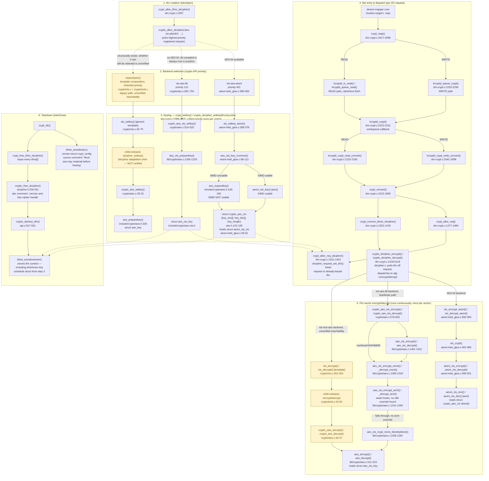

# The LUKS2 Master Key in Memory

[`af-splitting-explained.md`](af-splitting-explained.md) covers the
master key's copies *on disk*: each keyslot holds one, AF-split and
encrypted under a key derived from that keyslot's passphrase. This
document covers the copies *in memory*: where the plaintext key exists
while a volume is being unlocked and while it stays mapped, how the
kernel uses it for every sector, and how it is wiped when the volume is
closed. Every claim is checked against cryptsetup or Linux kernel
source pinned to a specific commit.

## Contents

- [What the master key is](#what-the-master-key-is)
- [Where the key lives in memory](#where-the-key-lives-in-memory)
  - [In cryptsetup, during unlock](#in-cryptsetup-during-unlock)
  - [In the kernel, while the volume is mapped](#in-the-kernel-while-the-volume-is-mapped)
- [How the kernel uses the key](#how-the-kernel-uses-the-key)
- [Key-lifecycle call graph](#key-lifecycle-call-graph)

## What the master key is

The master key (cryptsetup's source and man pages call it the *volume
key*) is the key dm-crypt uses to encrypt and decrypt the volume's
data. It is not derived from any passphrase. `luksFormat` generates it
from random bytes: `crypt_generate_volume_key()` fills it with
`crypt_random_get(..., CRYPT_RND_KEY)`
([`lib/volumekey.c`](https://gitlab.com/cryptsetup/cryptsetup/-/blob/bae21790d59897ac50e5471f953f76b3a58aeeb6/lib/volumekey.c#L206-238),
lines 206–238, the call on line 219). It stays the same for the life of
the volume unless you replace it with `cryptsetup reencrypt`, which can
"regenerate *volume key*"
([`man/cryptsetup-reencrypt.8.adoc`](https://gitlab.com/cryptsetup/cryptsetup/-/blob/bae21790d59897ac50e5471f953f76b3a58aeeb6/man/cryptsetup-reencrypt.8.adoc),
line 32). Its size is set at `luksFormat` time; see
[The key being split](af-splitting-explained.md#the-key-being-split).

A passphrase only unlocks a keyslot's copy of this key. Changing or
removing a passphrase does not change the key.

## Where the key lives in memory

The plaintext key exists in two places: briefly in the `cryptsetup`
process while it unlocks a keyslot, and for as long as the volume is
mapped in the kernel's dm-crypt target.

### In cryptsetup, during unlock

cryptsetup holds the unwrapped key in memory from
`crypt_safe_alloc()`
([`lib/utils_safe_memory.c`](https://gitlab.com/cryptsetup/cryptsetup/-/blob/bae21790d59897ac50e5471f953f76b3a58aeeb6/lib/utils_safe_memory.c#L42-85),
lines 42–85):

- `crypt_safe_alloc()` gets the buffer from `malloc()`, zeroes it, and
  calls `mlock()` on it so it is not swapped out. If `mlock()` fails,
  for example because the process is over its locked-memory limit, the
  failure is ignored ("Ignore failure if it is over limit.", line 56)
  and the buffer is used unlocked.
- `crypt_safe_free()` zeroes the buffer with
  `crypt_backend_memzero()`, unlocks it, and frees it.
  `crypt_backend_memzero()` uses `explicit_bzero()` where available and
  otherwise writes zeros through a `volatile` pointer, so the compiler
  cannot remove the zeroing as a dead store
  ([`lib/crypto_backend/memutils.c`](https://gitlab.com/cryptsetup/cryptsetup/-/blob/bae21790d59897ac50e5471f953f76b3a58aeeb6/lib/crypto_backend/memutils.c#L24-34),
  lines 24–34).

This is ordinary process heap memory. Any process allowed to read the
`cryptsetup` process's memory, such as one running as root, can read
the key while it is there. Nothing in LUKS defends against a hostile
root user on the same machine; the measures above only keep the key
out of swap (when `mlock()` succeeds) and out of freed memory.

### In the kernel, while the volume is mapped

When the volume is opened, the kernel's dm-crypt target keeps its own
copy of the key in `struct crypt_config`, whose last member is
`u8 key[] __counted_by(key_size);`
([`drivers/md/dm-crypt.c`](https://github.com/torvalds/linux/blob/43fd83c0b1dc127cf13b4c05303665924e63ef94/drivers/md/dm-crypt.c#L237),
line 237). The struct and the key bytes are allocated together on the
kernel heap with `kzalloc_flex(*cc, key, key_size)` (line 3202). The
copy stays there for as long as the volume is mapped, which is why a
mapped volume can be read and written without asking for the
passphrase again; it is not wiped when the volume is idle.

Reading this copy from userspace takes kernel-level access. On a
default kernel, root can read kernel memory through `/proc/kcore`,
which only requires `CAP_SYS_RAWIO`
([`fs/proc/kcore.c`](https://github.com/torvalds/linux/blob/43fd83c0b1dc127cf13b4c05303665924e63ef94/fs/proc/kcore.c#L635-643),
`open_kcore()`, lines 635–643). Kernel lockdown blocks this only in
*confidentiality* mode (`LOCKDOWN_KCORE` is a confidentiality reason,
[`include/linux/security.h`](https://github.com/torvalds/linux/blob/43fd83c0b1dc127cf13b4c05303665924e63ef94/include/linux/security.h#L104-157),
lines 104–157), and the default lockdown mode is none
([`security/lockdown/Kconfig`](https://github.com/torvalds/linux/blob/43fd83c0b1dc127cf13b4c05303665924e63ef94/security/lockdown/Kconfig#L19-27),
lines 19–27). `/dev/kmem` no longer exists: it was removed in Linux
v5.13
([`bbcd53c9`](https://github.com/torvalds/linux/commit/bbcd53c960713507ae764bf81970651b5577b95a),
`drivers/char: remove /dev/kmem for good`). Without root, reading the
key needs a kernel exploit or physical access to memory, as in cold
boot and DMA attacks; see
[`cold-boot-and-dma-attacks.md`](cold-boot-and-dma-attacks.md).

When the volume is closed (`cryptsetup close`), dm-crypt's destructor
`crypt_dtr()` frees the struct with `kfree_sensitive(cc)`, which zeroes
memory before freeing it; the source marks this step
`/* Must zero key material before freeing */` (lines 2738–2739).

## How the kernel uses the key

dm-crypt uses the key through a kernel crypto API object, a
*transform* (`tfm`, of type `struct crypto_skcipher`). Using it takes
three steps: create the `tfm`, key it once, then run it on every
sector.

1. **Create the `tfm`.** When the volume is opened, dm-crypt calls
   `crypt_alloc_tfms_skcipher()` (lines 2297–2325), which calls
   `crypto_alloc_skcipher()` with the volume's cipher, for example
   `aes-xts-plain64`. The kernel picks one of its registered
   implementations of that cipher (for AES-XTS on x86, normally the
   AES-NI one; see the call graph below). The `tfm` has no key yet.

2. **Key it once.** dm-crypt then calls `crypt_setkey()` (lines
   2388–2425), which passes the key to `crypto_skcipher_setkey()`
   (line 2414). This is the only call to `crypto_skcipher_setkey()` in
   `dm-crypt.c`; the per-sector path below never calls it. It expands
   the key into AES *key schedules*: for AES-256, the 15 round keys of
   `KeyExpansion()` in
   [FIPS 197](https://doi.org/10.6028/NIST.FIPS.197-upd1) (§5.2,
   pp.17–18, Algorithm 2: 4 × (Nr + 1) words, with Nr = 14). The
   schedule's first Nk words are the raw key itself (Algorithm 2, lines
   3–6; Nk = 8 for AES-256, so the whole 256-bit key fills the first two
   round keys). With XTS, the 64-byte key is two
   AES-256 keys, so there are two schedules, one for the data and one
   for the tweak. The schedules are stored inside the `tfm`.

   Which function does the expansion depends on the implementation the
   kernel picked in step 1:
   - **AES-NI**: `xts_setkey_aesni()`
     ([`arch/x86/crypto/aesni-intel_glue.c`](https://github.com/torvalds/linux/blob/ea0c746ffa1e6e701d39a564f6286a3f5740826b/arch/x86/crypto/aesni-intel_glue.c#L358-L376),
     lines 358–376) splits the key in half and stores one schedule in
     each `struct crypto_aes_ctx` of `struct aesni_xts_ctx { struct
     crypto_aes_ctx tweak_ctx; struct crypto_aes_ctx crypt_ctx; }`
     (lines 49–52), through `aes_set_key_common()` (lines 98–113).
     That normally runs the AES-NI routine `aesni_set_key()`, and
     falls back to `aes_expandkey()`
     ([`include/crypto/aes.h`](https://github.com/torvalds/linux/blob/d4e273a5065f81ca86eca48cb3fed55867cc0115/include/crypto/aes.h#L146-L160),
     lines 146–160: "Expands the AES key as described in FIPS-197")
     when SIMD instructions cannot be used.
   - **Generic `xts` template**:
     [`crypto/xts.c`](https://github.com/torvalds/linux/blob/cae575fc09fa824900939960e33bc49b8e964d80/crypto/xts.c#L42-L75)'s
     `xts_setkey()` (lines 42–75) splits the key and keys a child
     `ecb(aes)` transform with one half and a tweak cipher with the
     other, ending in `crypto/aes.c`'s `crypto_aes_setkey()` (lines
     26–32), which calls `aes_preparekey()` and stores the schedule in
     a `struct aes_key`.

3. **Run it on every sector.** For each encryption sector of a read or
   write, `crypt_convert()` (lines 1515–1606) calls `crypt_alloc_req()`,
   which for skcipher volumes calls `crypt_alloc_req_skcipher()` (lines
   1431–1453). That takes a request object from a memory pool only if
   the context has none (line 1436): the same request is reused for the
   next sector when the previous one completed synchronously, and a new
   one is taken after the previous one was handed to an asynchronous
   crypto driver (lines 1575–1579). Each time, it binds the request to
   the already-keyed `tfm` with `skcipher_request_set_tfm()` (line
   1442). `crypt_convert_block_skcipher()` (lines 1352–1418) then calls
   `crypto_skcipher_encrypt()` or `crypto_skcipher_decrypt()` (lines
   1416 and 1418), which dispatch to the chosen implementation; with
   AES-NI, `xts_encrypt_aesni()`/`xts_decrypt_aesni()` (registered at
   lines 580–593) reach the assembly routines `aesni_xts_enc()`/
   `aesni_xts_dec()` through `xts_crypt()` (lines 452–480) and
   `aesni_xts_encrypt()`/`aesni_xts_decrypt()` (lines 490–501), which
   read the schedules from the `struct crypto_aes_ctx` filled in step 2.
   This runs for every sector for as long as the volume is mapped.

`crypto_skcipher_encrypt()` appears once more in `dm-crypt.c`, at line
754, in `crypt_iv_eboiv_gen()` (lines 726–758), the IV generator for
the `eboiv` IV mode (selected at lines 2783–2784). It computes each
sector's IV by encrypting the sector's byte offset with one of the
volume's own `tfm` objects (`any_tfm(cc)`, line 729), so it also runs
per sector, but only for volumes that use `eboiv`; the default
`plain64` does not. It does not call `crypto_skcipher_setkey()`
either.

`crypt_setkey()` runs again only when the key is replaced in place:
`crypt_wipe_key()` (lines 2633–2650) fills `cc->key` with random bytes,
calls `crypt_setkey()` to load them into the existing `tfm` objects,
overwriting the schedules, and then zeroes `cc->key` (see
[`cold-boot-and-dma-attacks.md`](cold-boot-and-dma-attacks.md)).

Closing the volume frees the `tfm` objects as well as the struct.
`crypt_dtr()` calls `crypt_free_tfms()` (line 2714), which calls
`crypto_free_skcipher()` on each one (line 2281).
`crypto_free_skcipher()`
([`include/crypto/skcipher.h`](https://github.com/torvalds/linux/blob/f9bbd547cfb98b1c5e535aab9b0671a2ff22453a/include/crypto/skcipher.h#L328-L331),
lines 328–331) is documented as "zeroize and free cipher handle" and
calls `crypto_destroy_tfm()`
([`crypto/api.c`](https://github.com/torvalds/linux/blob/cae575fc09fa824900939960e33bc49b8e964d80/crypto/api.c#L617-L631),
lines 617–631), which frees it with `kfree_sensitive()`. So on close
the key material is zeroed in two places: in each `tfm`, which holds
the key schedules, and in `struct crypt_config`, which holds the raw
key.

## Key-lifecycle call graph

The three steps above leave out branches: which functions run depends
on which of three kernel implementations of `xts(aes)` the crypto API
selects, and the per-sector path starts from a bio-submission chain.
The diagram traces the key from `luksOpen` through per-sector I/O to
`luksClose`, each edge checked against kernel source at the pinned
commits in the table below. It covers only the key's lifecycle; it
does not trace tweak/IV generation or the userspace unlock path.

Amber nodes exist in the source but have at least one unverified
edge. The most important is the `lskcipher`-to-`skcipher` adaptation
that lets `crypto/xts.c`'s generic template use `ecb(aes)`, which
`crypto/ecb.c` has registered as an `lskcipher`, not a `skcipher`,
since Linux v6.7
([`32a8dc4a`](https://github.com/torvalds/linux/commit/32a8dc4afcfb098ef4e8b465c90db17d22d90107),
`crypto: ecb - Convert from skcipher to lskcipher`).

**Why `xts(aes)` has three implementations.** An earlier version of
`af-splitting-explained.md` cited `crypto_aes_expand_key()` in
`crypto/aes_generic.c` as the AES key-schedule routine. That function
was real but long outdated. Linux v5.4 replaced it with the shared
library routine `aes_expandkey()` in `lib/crypto/aes.c`
([`5bb12d78`](https://github.com/torvalds/linux/commit/5bb12d7825adf0e80b849a273834f3131a6cc4e1),
`crypto: aes-generic - drop key expansion routine in favor of library
version`), and v7.0 deleted `crypto/aes_generic.c`, replacing it with
`crypto/aes.c`, a Crypto API wrapper around that library
([`a2484474`](https://github.com/torvalds/linux/commit/a2484474272ef98d9580d8c610b0f7c6ed2f146c),
`crypto: aes - Replace aes-generic with wrapper around lib`). At this
diagram's pinned commits, all of which are part of the v7.3 release,
`xts(aes)` is registered three separate times: AES-NI's
`xts-aes-aesni`; the library-backed `xts-aes-lib`, which v7.3 added to
`crypto/aes.c`
([`94efa0c9`](https://github.com/torvalds/linux/commit/94efa0c9fb36b0f8be480f24bce2bb673005bfde),
`crypto: aes - Add XTS support using library`); and the generic `xts`
template over `ecb(aes)`. `crypto_alloc_skcipher()` picks the highest
`cra_priority` available, so the setup, keying and encrypt/decrypt
layers branch three ways. Unreleased kernel master has since moved
x86's AES-NI XTS code into the library
([`2bd68888`](https://github.com/torvalds/linux/commit/2bd6888849d6d2d5497c2470cc71c8d2cb170523))
and raised `xts-aes-lib`'s x86 priority to 500
([`f410daa3`](https://github.com/torvalds/linux/commit/f410daa32cfcd94263f156662a1ad2097505443c));
this diagram does not reflect that yet.

**Citations.** All line numbers above refer to these pinned commits,
rechecked on 2026-10-28:

| File | Pinned commit |
|---|---|
| `drivers/md/dm-crypt.c` | [`43fd83c0`](https://github.com/torvalds/linux/tree/43fd83c0b1dc127cf13b4c05303665924e63ef94/drivers/md/dm-crypt.c) |
| `arch/x86/crypto/aesni-intel_glue.c` | [`ea0c746f`](https://github.com/torvalds/linux/tree/ea0c746ffa1e6e701d39a564f6286a3f5740826b/arch/x86/crypto/aesni-intel_glue.c) |
| `include/crypto/aes.h` | [`d4e273a5`](https://github.com/torvalds/linux/tree/d4e273a5065f81ca86eca48cb3fed55867cc0115/include/crypto/aes.h) |
| `crypto/aes.c` | [`f70ad727`](https://github.com/torvalds/linux/tree/f70ad727d1d60a4dfcb1a22152d4169f9a205af9/crypto/aes.c) |
| `lib/crypto/aes.c` | [`561131a2`](https://github.com/torvalds/linux/tree/561131a27f5533e6e63520b4bc43d9c832a27c09/lib/crypto/aes.c) |
| `crypto/xts.c` | [`cae575fc`](https://github.com/torvalds/linux/tree/cae575fc09fa824900939960e33bc49b8e964d80/crypto/xts.c) |
| `crypto/ecb.c` | [`ef93f156`](https://github.com/torvalds/linux/tree/ef93f1562803cd7bb8159e3abedaf7f47dce4e35/crypto/ecb.c) |
| `include/crypto/skcipher.h` | [`f9bbd547`](https://github.com/torvalds/linux/tree/f9bbd547cfb98b1c5e535aab9b0671a2ff22453a/include/crypto/skcipher.h) |
| `crypto/api.c` | [`cae575fc`](https://github.com/torvalds/linux/tree/cae575fc09fa824900939960e33bc49b8e964d80/crypto/api.c) |

A browsable version of this diagram, with pan, zoom and search, is at
[`docs/diagrams/key-lifecycle.html`](diagrams/key-lifecycle.html). Open
it in a browser; it loads Mermaid and its fonts from a CDN.
